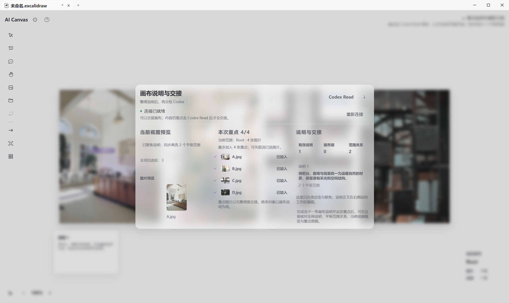
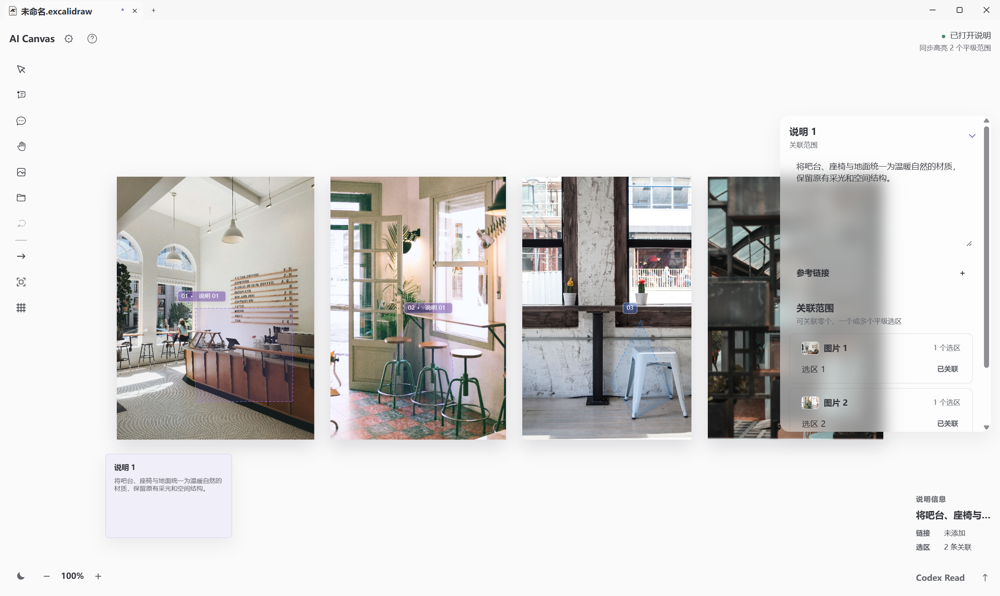
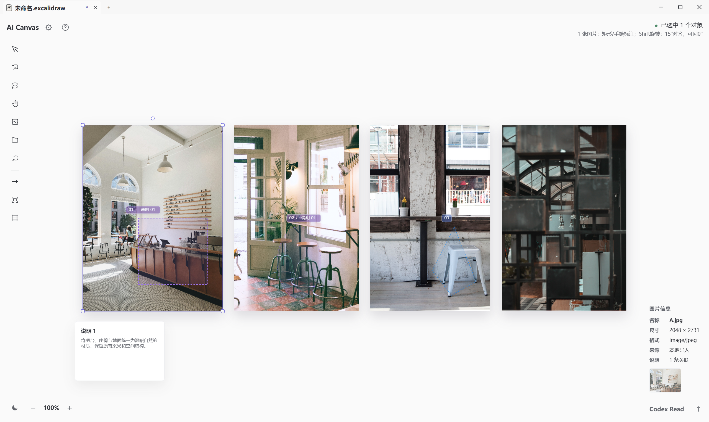
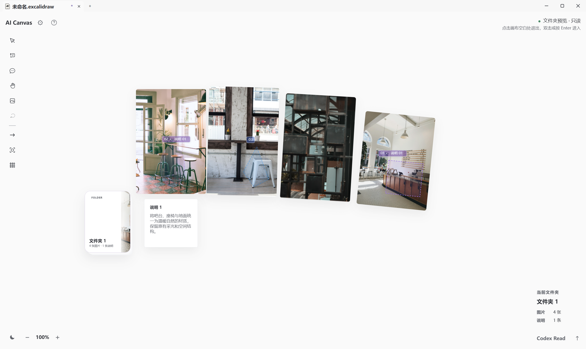
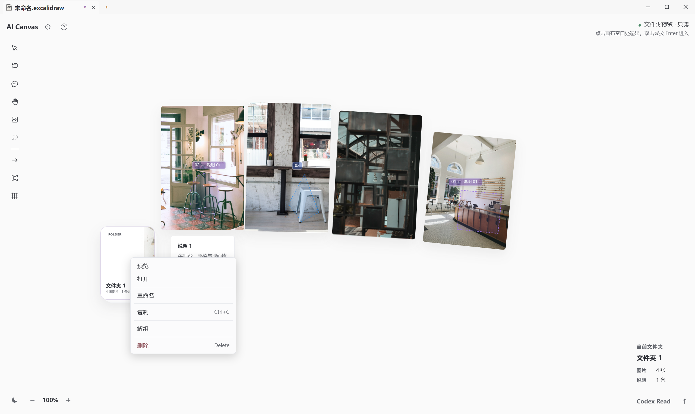
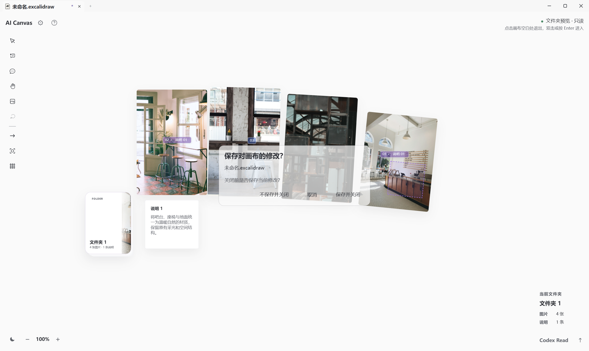
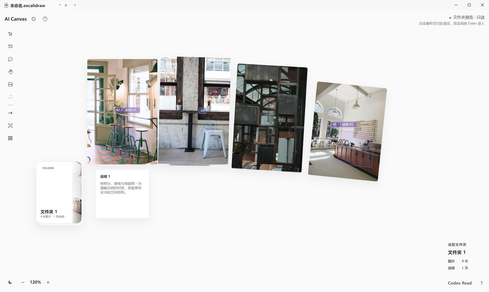
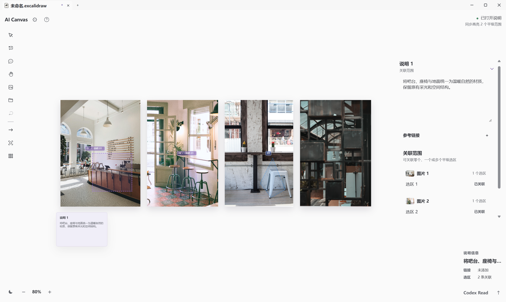
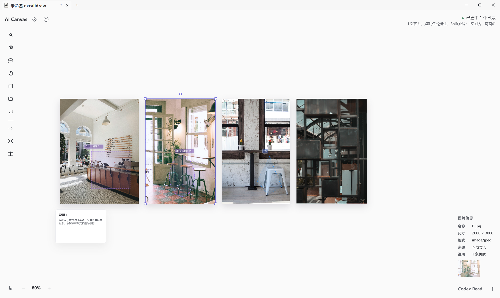

# AI Canvas 1.0.16 实际界面 · 九张截图

九张全部取自已安装正式 1.0.16 的同一虚拟机，使用指定的四张演示图。前六张与后来补截的三张均保留。实际窗口捕获，未修图；不含进入文件夹后的画布。静态截图不替代动画全过程或完整生成流程验收。

## Read 面板与图片预览

## 说明编辑器与关联范围

## 图片信息栏 · A.jpg

## 文件夹预览与选区对齐

## 文件夹入口与菜单

## 关闭前保存提示

## 文件夹预览补图 · 120%

## 说明编辑补图 · 正文与两个已关联范围

## 图片信息补图 · B.jpg

摄影来源见[图片署名](PHOTO-CREDITS.md)。
